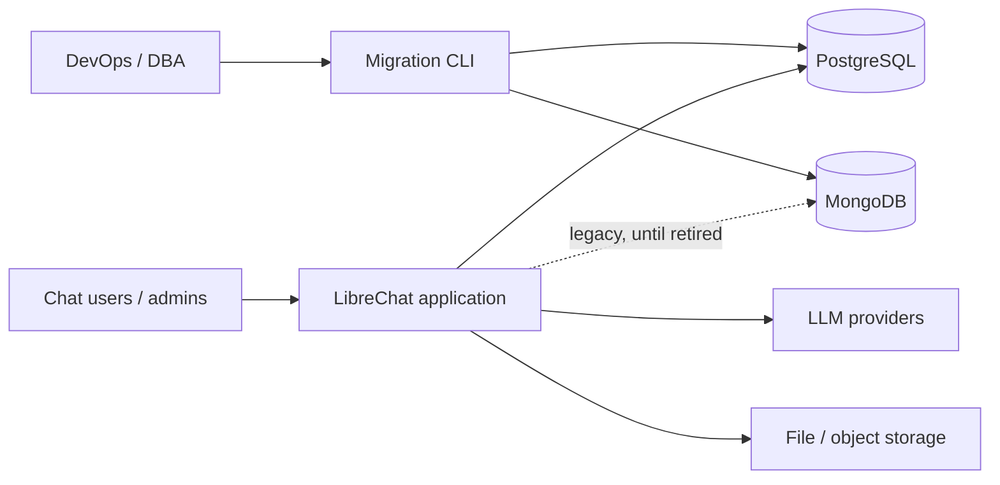

# LCMIG – Solution Architecture (MongoDB → PostgreSQL persistence layer)

## Changes from previous version

- **Volumes and sizes are deferred**, as the architect instructed. No decision, NFR or gate below depends on a data-volume estimate. Sizing is a post-architecture activity (see §10). Migration tooling is designed to be size-independent: batched, resumable and streaming.
- **The focus is the conversion of the Mongo data layer to a Postgres layer.** The document now centres on the concrete conversion path:
  - the persistence port interfaces (§3.2)
  - the Mongo and Postgres adapters (§3.2)
  - the entity-to-table mapping (§6)
  - the ID strategy (ADR-004)
  - the migration pipeline (§7)
  - the conversion sequence (§9)
- Blocking open questions from scope that were about volumes, dates, budget or deployments are recorded as **assumptions** (§11), not blockers.

## 1. Quality goals

| #   | Quality attribute                      | Why (scope link)                                 | Drives                                                                     |
| --- | -------------------------------------- | ------------------------------------------------ | -------------------------------------------------------------------------- |
| Q1  | **Modifiability / replaceability**     | G1, constraint "module-based, not a direct swap" | Ports and adapters, lint-enforced boundary, module registry                |
| Q2  | **Data integrity**                     | G2, no-loss constraint                           | Relational constraints, transactions, idempotent migration, reconciliation |
| Q3  | **Functional parity**                  | G3                                               | Shared contract test suite run against both adapters                       |
| Q4  | **Operability and safe cutover**       | G5, DBA/ops stakeholders                         | Versioned migrations, runbook, rollback, observability                     |
| Q5  | **Performance (relative to baseline)** | G4                                               | Index design, load tests vs. Mongo baseline                                |

Security (encryption in transit and at rest, least privilege) is a cross-cutting constraint, not a top-5 driver.

## 2. System context (C4 level 1)



Out of the boundary and unchanged: LLM providers, file/object storage, and any search index or cache. The assumption is that none of these is touched (§11, A5).

## 3. Container view (C4 level 2)

### 3.1 Containers

| Container                             | Technology                           | Responsibility                                                                       |
| ------------------------------------- | ------------------------------------ | ------------------------------------------------------------------------------------ |
| LibreChat API and services (existing) | Node.js / TypeScript                 | Business logic. Depends **only** on persistence ports.                               |
| `persistence-core` (new package)      | TypeScript                           | Repository interfaces, domain types, error types, module registry, contract test kit |
| `persistence-mongo` (adapter)         | TypeScript, existing Mongoose models | Wraps today's data access behind the ports (the reference implementation)            |
| `persistence-postgres` (adapter)      | TypeScript, Kysely, `pg`             | Implements every port on PostgreSQL                                                  |
| `lcmig` migration CLI (new)           | TypeScript, Node streams             | Extract from Mongo, transform, load into Postgres, reconcile                         |
| PostgreSQL                            | Current supported major version      | System of record after cutover                                                       |
| MongoDB                               | Existing                             | System of record until cutover, then rollback source                                 |

### 3.2 Conversion architecture: from the Mongo layer to the Postgres layer

```mermaid
flowchart TB
  S[Services / routes / middleware] --> P[Ports: UserRepo, ConversationRepo, MessageRepo, ConfigRepo, ...]
  P --> R{Module registry\nPERSISTENCE_MODULE=mongo|postgres}
  R --> M[persistence-mongo]
  R --> G[persistence-postgres]
  M --> MG[(MongoDB)]
  G --> PG[(PostgreSQL)]
```

Conversion rules:

1. **Extract ports from existing behaviour.** For each Mongoose model and data-access method used today, define a port method in `persistence-core`. Ports use domain types, string IDs, explicit pagination (cursor-based) and explicit transactions (`unitOfWork`). They have **no** Mongo concepts (no `ObjectId`, query operators, `populate` or `lean`).
2. **Mongo adapter first.** Re-home the existing code behind the ports with no behaviour change. This is the safe step, and the existing tests must stay green.
3. **Refactor services** to call ports only. A CI lint rule (`no-restricted-imports` for `mongoose`, `mongodb` and Mongoose model paths outside `persistence-mongo`) enforces G1.
4. **Postgres adapter** implements the same ports. It must pass the shared **contract test kit**, which runs every test against both adapters (G3).
5. **Selection by config:** `PERSISTENCE_MODULE` (and `DATABASE_URL`) chooses the adapter at startup. There is no runtime dual-write in the MVP.

## 4. Technology stack

| Concern              | Choice                                                                     | Rationale                                                            |
| -------------------- | -------------------------------------------------------------------------- | -------------------------------------------------------------------- |
| Language / runtime   | TypeScript on Node.js (as the repo)                                        | No new stack                                                         |
| Postgres access      | **Kysely** + `pg` (ADR-002)                                                | Typed SQL without hiding it. Easy to review and tune. Light runtime. |
| Schema migrations    | SQL-first versioned migrations (Kysely migrator, plain `.sql`/`.ts` files) | DBA-readable, forward-only, reviewed in PRs                          |
| Dynamic fields       | `JSONB` only for genuinely schemaless data (ADR-003)                       | Mitigates the schema-less mapping risk                               |
| IDs                  | UUIDv7 primary keys plus `legacy_id` (ADR-004)                             | Idempotent migration, preserves external references                  |
| Tests                | Existing runner (Jest), Testcontainers for Postgres and Mongo              | Hermetic parity and migration tests                                  |
| Migration CLI        | Node streams with cursor-based batching and checkpoint table               | Size-independent design                                              |
| Boundary enforcement | ESLint restricted-imports and dependency-cruiser in CI                     | Objective G1 measurement                                             |

## 5. ADRs (summary)

- **ADR-001 Ports-and-adapters persistence module.** The decision is a core package of interfaces, with one adapter per database selected by config. The alternative, direct Mongoose→ORM replacement, is rejected by the scope constraint because it only moves the coupling. The consequence is an up-front refactor, which gives a swappable layer.
- **ADR-002 Kysely as the Postgres access layer.** Alternatives are Prisma and Drizzle (heavier codegen or abstraction; less control over SQL) and TypeORM (Active-Record leakage, and it would re-introduce coupling). The decision is reversible because it is confined to one adapter.
- **ADR-003 Hybrid relational/JSONB model.** Stable, queried and constrained fields become columns, with foreign keys and constraints. Variable provider-specific blobs such as model parameters, plugin payloads and message `content` parts become `JSONB`. Fields that are queried or filtered must be promoted to columns.
- **ADR-004 ID strategy.** Every migrated row gets a new UUIDv7 `id`. The original Mongo `_id` is kept in `legacy_id` (unique, indexed). The application's existing string-based business keys (e.g. `conversationId`, `messageId`) are kept as unique columns. Ports expose IDs as opaque strings, so no caller depends on the ObjectId format. This makes reruns idempotent (`INSERT … ON CONFLICT (legacy_id) DO UPDATE`).
- **ADR-005 One-time offline cutover (MVP).** Stop writes, run the final delta pass, reconcile, then switch `PERSISTENCE_MODULE`. Dual-write or live-sync is deferred ("Later" in scope). Rollback means flipping the config back to Mongo, which stays untouched and read-only until the sign-off period ends.
- **ADR-006 Contract-test-driven parity.** One test kit is parameterised over adapters. It covers ordering, pagination, uniqueness errors, transaction semantics and null/default handling.

## 6. Data conversion: entity mapping

The final collection list is confirmed by a **code audit of the existing Mongoose models** in the first sprint. This is deterministic and needs no volume information. The expected set follows; the audit may add to it.

| Mongo collection (expected)                     | Postgres target                                        | Notes                                                                                                                 |
| ----------------------------------------------- | ------------------------------------------------------ | --------------------------------------------------------------------------------------------------------------------- |
| users                                           | `users` (+ `user_identities` for OAuth/provider links) | Unique email/username. Hashed passwords are copied as-is.                                                             |
| sessions / refresh tokens                       | `sessions`                                             | If stored in Mongo today (audit)                                                                                      |
| conversations                                   | `conversations`                                        | `conversation_id` unique, FK to user, tags as `text[]` or a child table                                               |
| messages                                        | `messages`                                             | FK to conversation, `parent_message_id` self-reference, `content` as JSONB, index `(conversation_id, created_at, id)` |
| presets, prompts / prompt groups                | `presets`, `prompts`, `prompt_groups`                  | Parameters as JSONB                                                                                                   |
| agents, assistants, actions                     | `agents`, `assistants`, `actions`                      | Tool/config blobs as JSONB, relations as FKs or link tables                                                           |
| files (metadata only)                           | `files`                                                | Binaries stay in the current file store                                                                               |
| roles, permissions / ACL, groups                | `roles`, `acl_entries`, `groups`, `group_members`      | Real FKs. Replaces implicit references.                                                                               |
| balance, transactions                           | `balances`, `token_transactions`                       | Numeric columns and ledger constraints                                                                                |
| shared links, banners, keys, tool calls, config | One table each (decided in the audit)                  |                                                                                                                       |

Conventions:

- Snake_case names, `timestamptz` for dates, `NOT NULL` and `CHECK` where the domain guarantees them, and FKs with explicit `ON DELETE`.
- Migrations are forward-only and numbered, and run automatically only in dev and test. Prod runs them through an explicit step in the runbook.

## 7. Migration pipeline (`lcmig`)

Stages: **profile → extract → transform → load → reconcile → report**.

1. **Profile:** scans each collection and reports field presence, type variance and nulls, so the mapping spec is evidence-based.
2. **Extract:** streams by `_id` cursor in configurable batches (batch size is a parameter, not a design assumption). The checkpoint is stored in a `migration_checkpoint` table.
3. **Transform:** pure, unit-tested mapping functions per entity. Invalid records go to a `migration_rejects` table with the reason. They are never dropped silently.
4. **Load:** `COPY` or multi-row upserts inside batch transactions. Idempotent through `legacy_id`. Tables are loaded in FK dependency order, and order within a table is deterministic.
5. **Reconcile:** compares per-entity counts and per-row content checksums (canonical hash of the mapped fields) in both directions. It outputs a machine-readable and a human-readable report. Any unresolved discrepancy blocks the cutover (G2).
6. **Modes:** `--dry-run`, `--resume`, `--entity=…` and a `--delta` pass (re-copy of records changed since the last run, by `updatedAt`) for the final cutover step.

## 8. Cross-cutting concepts

- **AuthN/AuthZ:** unchanged behaviour (existing strategies). Only the user/session/ACL storage moves behind ports. Postgres uses a least-privilege application role. The migrator role is separate and has DDL rights.
- **Transport and data security:** TLS to Postgres (`sslmode=verify-full`), secrets via env or secret store only, at-rest encryption by the Postgres/hosting platform. No secrets in logs or reports. Reject reports are scrubbed of message content, with record IDs only.
- **API style:** the external REST API is unchanged, so there are no UI changes. Ports are internal TypeScript interfaces. Errors use a typed port error model (`NotFound`, `Conflict`, `ConstraintViolation`, `Transient`) that adapters map to. Services translate these to existing HTTP responses (RFC 9457 `problem+json` for any new endpoints).
- **Observability:** structured logs, and per-port-method duration and error metrics (labelled by adapter) so the Mongo-versus-Postgres comparison for G4 comes from the same instrumentation. Postgres is monitored with `pg_stat_statements`, connection pool metrics, and migration progress metrics.
- **Configuration (12-factor):** `PERSISTENCE_MODULE`, `DATABASE_URL`, `PG_POOL_MAX`, `PG_SSL_MODE`, plus `MONGO_URI` retained for the Mongo adapter and the migrator.
- **Data management:** migrations are versioned and reviewed. Backups use standard `pg_dump` or PITR (platform choice). The rollback source (Mongo) is kept read-only after cutover for an agreed retention period (TBD).

## 9. Conversion sequence (maps to epics)

1. **E1:** audit models and services (dependency audit). Define ports and the registry. Add the lint rule in warn mode.
2. **E1/E4:** build the Mongo adapter behind the ports and refactor services in slices (users → conversations/messages → remaining). The lint rule moves to error for each migrated slice.
3. **E2:** schema design and the first migrations. Architect review.
4. **E3:** the Postgres adapter, slice by slice, each gated by the contract tests.
5. **E5:** `lcmig`, built alongside the mapping of each slice.
6. **E6:** full parity, regression and load tests, with both adapters in CI.
7. **E7:** staging rehearsal, cutover runbook, rollback test, operator docs, module-authoring guide.

## 10. Non-functional requirements (measurable)

| ID    | Scenario                                                                  | Target                                                                               |
| ----- | ------------------------------------------------------------------------- | ------------------------------------------------------------------------------------ |
| NFR-1 | Static check on services                                                  | 0 imports of `mongoose` or `mongodb` outside `persistence-mongo`; CI fails otherwise |
| NFR-2 | Contract test suite on both adapters                                      | 100% pass on each                                                                    |
| NFR-3 | Existing regression suite on Postgres                                     | 100% pass                                                                            |
| NFR-4 | p95 latency of load conversation, list conversations, save message, login | ≤ Mongo baseline +10% (threshold to be confirmed) on the performance test dataset    |
| NFR-5 | Reconciliation after a full run                                           | 0 count mismatches, 0 checksum mismatches, 0 unexplained rejects                     |
| NFR-6 | Rerun of `lcmig` on an already-migrated dataset                           | 0 duplicate rows, identical reconciliation report (idempotency)                      |
| NFR-7 | Interrupted run, then `--resume`                                          | Completes without reprocessing committed batches                                     |
| NFR-8 | Rollback rehearsal in staging                                             | Config flip to Mongo restores service, verified by smoke tests                       |
| NFR-9 | Connection security                                                       | All Postgres connections use TLS in non-dev environments                             |

**Sizing (deferred):** dataset size, migration duration, downtime window, pool sizing and hardware are measured in the staging rehearsal against a production-like dataset. They become NFR thresholds at that point. They do not affect the architecture above.

## 11. Assumptions and open items

- **A1.** The compatibility check is complete, and its findings feed the Architecture review. They may add risks but are not blocking.
- **A2.** The MVP targets one deployment type, using a one-time cutover with a downtime window. The tool is deployment-agnostic, so other deployments can reuse it.
- **A3.** Postgres is the current supported major version (hosting model TBD). It needs no extensions beyond the built-ins (`pgcrypto` or `uuid` not required, because UUIDv7 is generated in the app).
- **A4.** The ORM or query layer was left to the architect, and the choice is ADR-002.
- **A5.** Non-database stores (files, search index, cache) are unchanged. The audit flags any other Mongo dependency (for example vector or RAG storage) for a BA decision, not as a blocker.
- **A6.** The Mongo module is retained after go-live. Its retention period is TBD (removal is a "Later" item).
- Dates, budget, team size, baselines and compliance details are TBD and do not block the architecture.

## 12. Repository structure and delivery

**Monorepo decision:** work within the existing LibreChat repository (packages already live there). Separate repos would add versioning overhead for tightly coupled packages.

```
/packages
  /persistence-core        # ports, domain types, errors, registry, contract-test kit
  /persistence-mongo       # adapter over existing Mongoose models
  /persistence-postgres
    /src                   # repositories, unit of work, pool
    /migrations            # versioned SQL migrations
  /lcmig                   # migration CLI: profile, extract, transform, load, reconcile
    /mappings              # per-entity mapping functions and specs
/api                       # services refactored to depend on ports only
/docs
  /adr                     # ADR-001..006
  /persistence             # module-authoring guide
  /migration               # runbook, rollback plan, operator notes
/.github/workflows         # CI
```

**CI stages:**

1. Lint and typecheck (includes the restricted-import rule).
2. Unit tests.
3. Contract tests on Mongo and Postgres (Testcontainers).
4. Migration tests (fixture Mongo → Postgres → reconcile, plus idempotency and resume).
5. Regression and integration suite on both modules (matrix).
6. Security checks (dependency audit, secret scan).
7. Build.
8. Manual or nightly performance job.

**Environments:** dev (local containers), test (CI, ephemeral), staging (production-like, used for the rehearsals), prod.

**Branching:** trunk-based with a protected `main`, short-lived branches named `LCMIG-<n>-…`, PR review required, and the default module remaining `mongo` until the cutover PR flips the default.

## 13. Risks and accepted technical debt

| Risk / debt                                                                   | Mitigation / decision                                                                                         |
| ----------------------------------------------------------------------------- | ------------------------------------------------------------------------------------------------------------- |
| Abstraction leaks Mongo concepts                                              | Architect reviews port design. Lint rule. The Postgres adapter is the second implementation that proves it.   |
| Schema-less data does not map cleanly                                         | Profiling. JSONB for dynamic fields. Reject table.                                                            |
| Behavioural differences (ordering, ID format, case-sensitivity, transactions) | Contract tests. ID strategy ADR-004. Explicit collation and ordering in ports.                                |
| Long migration time (unknown size)                                            | Batching and resumability are built in. Parallel per-entity loading is available. Dual-write remains "Later". |
| Broad refactor and scope creep                                                | Slice-by-slice delivery, with changes controlled by the BA.                                                   |
| Accepted debt: two adapters maintained until Mongo removal                    | Removal is a planned follow-up.                                                                               |
| Accepted debt: no live-sync, so downtime is required at cutover               | Accepted for the MVP (ADR-005).                                                                               |
| Accepted debt: Postgres-specific optimisations (partitioning, FTS, replicas)  | Deferred ("Later").                                                                                           |
